# ADA Harness

**A small, open template for building an AI harness.**

A language model receives tokens and returns tokens. That is all it does. A *harness* is the structure around that call: it decides which tokens go in, runs what the model asks for, and calls again. This template leaves that structure in text files you can read, version, and change, plus a small chat where you watch each layer work live.

It works with **Claude** (Anthropic), **Gemini** (Google), and **local models through Ollama**, with no key and no per-token cost when Ollama is running: the harness detects it on its own. You pick the model in the chat or with a variable, and the loop stays the same.

`npm install`, then `npm start`. Node 18 or newer. One runtime dependency, `ajv`, checks tool arguments. TypeScript compiles the engine. Tests that need no keys and no network, written architecture decisions, and a use-case process with tests first for the front end. MIT license.

The Spanish guide is [README.es.md](README.es.md).

## Start here

```bash
git clone https://github.com/ada-school/ada-harness.git
cd ada-harness
cp .env.example .env          # one key, or none if you use Ollama
npm install
npm start                     # http://localhost:3000
```

To build software that already lives in another repo, set its path as `ADA_WORKSPACE` in `.env` and describe the stack in `AGENTS.md`. The agent reads, writes, and runs commands only there. The steps are in [Point it at your project](#10-point-it-at-your-project). The rest of this file explains how the harness is built.

The plan to finish the move to English, take the engine to TypeScript one module at a time, and keep the chat off React is in [`docs/BACKLOG.md`](docs/BACKLOG.md).

---

## Contents

1. [Start with the interactive explainer](#1-start-with-the-interactive-explainer)
2. [The idea in one diagram](#2-the-idea-in-one-diagram)
3. [Context layers](#3-context-layers)
4. [Repository layout](#4-repository-layout)
5. [The agent loop](#5-the-agent-loop)
   - [One loop, several models: Claude, Gemini, and Ollama](#one-loop-several-models-claude-gemini-and-ollama)
   - [Local, free models with Ollama](#local-free-models-with-ollama)
   - [Add another provider](#add-another-provider)
6. [When the window fills](#6-when-the-window-fills)
7. [Subagents](#7-subagents)
8. [The minimal chat and its inspector](#8-the-minimal-chat-and-its-inspector)
   - [Building screens: use cases and tests first](#building-screens-use-cases-and-tests-first)
9. [Install and use](#9-install-and-use)
   - [Tests and types](#tests-and-types)
10. [Point it at your project](#10-point-it-at-your-project)
11. [Principles this structure enforces](#11-principles-this-structure-enforces)
    - [Architecture decisions](#architecture-decisions)
12. [Known limits](#12-known-limits)

[Developing this repo with Claude Code](#developing-this-repo-with-claude-code) · [In-person workshop](#in-person-workshop) · [References](#references)

---

## 1. Start with the interactive explainer

This repo started from a mental model, and that model lives in one file:

**[`docs/Anatomía de un Agente.html`](docs/Anatom%C3%ADa%20de%20un%20Agente.html)**

Open it in a browser (or at `http://localhost:3000/docs/Anatom%C3%ADa%20de%20un%20Agente.html` with the server running). Eight layers, each with an interactive piece:

| Layer | What it shows | Interaction |
|---|---|---|
| 1. The call | The model picks the next token from a distribution | Temperature slider and sampling |
| 2. Focus | Context does not add knowledge. It concentrates probability on a region | Animated map. Write your own prompt |
| 3. Context | How the real prompt is assembled, and what each layer weighs | Turn layers on and off |
| 4. The loop | An agent is a loop around the call | Step through a real task |
| 5. Full window | Quality drops before the limit, and the three moves available | Fill the window, truncate, compact, or offload |
| 6. Subagents | Another context, empty, with the same loop | Diagram of three contexts |
| 7. Map | Every layer: who writes it, when it enters, whether it persists | Reference |
| 8. What does not change | Six truths no layer changes | Reference |

Each folder in this repository implements one of those layers. The sections below follow the same order.

---

## 2. The idea in one diagram

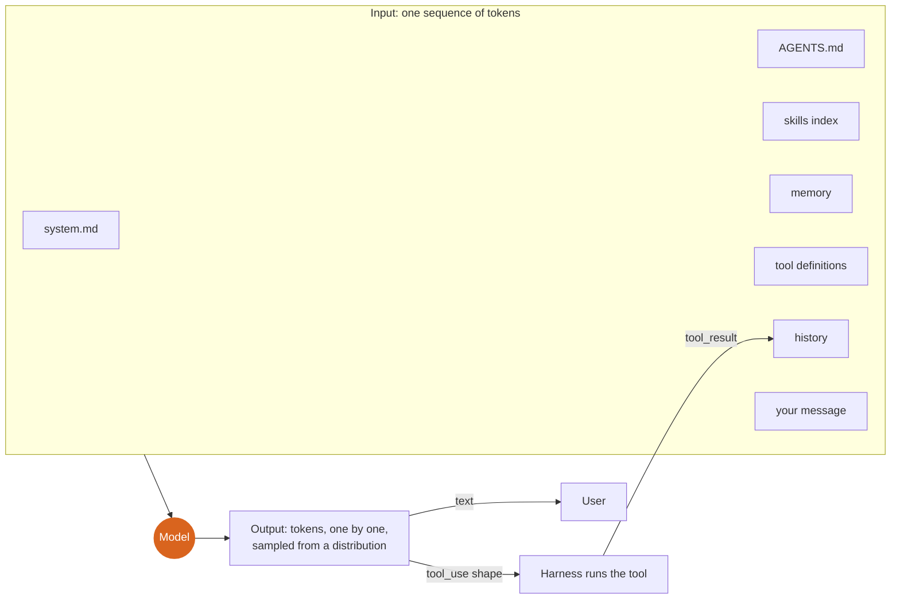

Three things to keep:

- The model **remembers nothing** between calls. What it "knows" is what is in the input.
- The model **runs nothing**. When it "uses a tool" it is emitting text in an agreed shape. The harness reads it and runs it.
- The output is **probabilistic**. Two identical calls can differ.

---

## 3. Context layers

Everything that enters the call is text, ordered in layers. Each layer has an owner, a load time, and a token cost. `harness/routing.json` declares how each one loads.

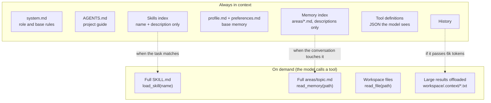

| Layer | File or source | Who writes it | When it enters |
|---|---|---|---|
| System prompt | `harness/system.md` | You (a human, with approval) | Always |
| Project guide | `AGENTS.md` | You and your team | Always, concatenated to the system prompt |
| Skills index | frontmatter of `harness/skills/*/SKILL.md` | Whoever writes the skill | Always |
| A skill's body | body of `SKILL.md` | Whoever writes the skill | On demand, `load_skill` |
| Base memory | `harness/memory/profile.md`, `preferences.md` | You, by hand | Always |
| Memory index | `harness/memory/areas/*.md` (descriptions) | The agent, with `write_memory` | Always |
| Memory body | body of `areas/*.md` | The agent | On demand, `read_memory` |
| Tools | `harness/tools/index.ts` | You | Always |
| History | `.sessions/sessions.json` (`src/http/api.ts`) | You and the model | Always, until compaction |
| Tool results | what each run returns | The outside world | After each run |

**Index in, body out.** The same pattern in skills, memory, and large results. The model always sees what exists. It loads the full body only when it needs it. In the explainer this is "context routing".

---

## 4. Repository layout

```
ada-harness/
├── AGENTS.md                      Project guide for the harness agent. Concatenated to its system prompt.
├── CLAUDE.md                      Guide for whoever develops this repo with Claude Code.
├── harness/                       Everything that defines the agent. Text only.
│   ├── system.md                  Role and base rules.
│   ├── routing.json               Which layer is always in, on demand, or never; budgets.
│   ├── skills/
│   │   ├── README.md              How to write a skill.
│   │   ├── commit-convention/SKILL.md
│   │   ├── spec-first/SKILL.md
│   │   └── frontend-tdd/          Front-end process: use cases and tests first.
│   │       ├── SKILL.md           The steps: use case, red, green, cleanup, done when.
│   │       ├── arquitectura.md    Front-end rules, taken from docs/decisiones/.
│   │       └── plantilla-caso-de-uso.md
│   ├── memory/
│   │   ├── profile.md             Who uses the harness.
│   │   ├── preferences.md         How they want the agent to behave.
│   │   └── areas/                 One file per project or topic. The agent writes them.
│   ├── agents/                    One file per agent: frontmatter (name, description) plus prompt.
│   │   ├── researcher.md          Explores and summarizes.
│   │   ├── reviewer.md            Reviews one change and runs its tests.
│   │   ├── frontend.md            Builds screens with use cases and tests first.
│   │   └── qa.md                  Reviews the whole project against decisions, use cases, and tests.
│   └── tools/
│       └── index.ts               Each tool: JSON definition plus the function that runs it.
├── bin/
│   └── ada.js                     One command: chat, one turn, or the weight of the layers.
├── src/                           The engine. Each file has one job. Node runs the compiled files under dist/.
│   ├── harness.ts                 The loop: call, run tools, subagents, turn().
│   ├── context.ts                 Layer assembly and the token estimate.
│   ├── window.ts                  The window: budget, compact(), maybeOffload().
│   ├── config.ts                  Paths, protected files, and .env loading.
│   ├── types.ts                   Exported types. Provider is an interface. No runtime value.
│   ├── validation.ts              The JSON Schema subset the server checks.
│   ├── text.ts                    Error sentences. English by default. Spanish when ADA_LANG=es.
│   ├── cli.ts                     The argument reader. It dispatches serve, run, and capas.
│   ├── providers/
│   │   ├── index.ts               The registry and the provider choice.
│   │   ├── anthropic.ts           The Claude adapter. The internal format is already its format.
│   │   ├── gemini.ts              The Gemini adapter. It translates to generateContent and keeps signatures.
│   │   └── ollama.ts              The local adapter. It detects Ollama and models with tools.
│   ├── http/
│   │   ├── static.ts              The file server: app/ and docs/, nothing else.
│   │   └── api.ts                 /api/providers, /api/chat, /api/reset, and sessions.
│   └── server.ts                  The HTTP server. It joins the static files and the API. `listen()` is what the command uses.
├── app/                           The chat. HTML, CSS, and native ES modules: no build.
│   ├── index.html                 Structure only.
│   ├── styles.css                 Colors per layer, the same as the explainer.
│   └── js/
│       ├── main.js                Wires events, state, and modules. Decides nothing.
│       ├── api.js                 The three calls to the server.
│       ├── conversacion.js        When to send, and what to show from each reply (pure logic).
│       ├── selector.js            Model selector options (pure logic plus render).
│       ├── inspector.js           What the inspector shows (pure logic plus render).
│       ├── chat.js                Paints the messages.
│       └── format.js              Numbers and the color of each layer.
├── docs/
│   ├── Anatomía de un Agente.html    The interactive explainer.
│   ├── decisiones/                    Why the project is this way: one decision per file.
│   ├── casos-de-uso/                  What each screen must achieve, with numbered criteria.
│   └── taller/                        Workshop material: template, solved example, and descuentos.js.
├── tests/                         No keys and no external network. See "Tests and types".
│   ├── unit/                      Tools, context, window, agents, HTTP, terminal.
│   │   ├── app/                   The chat: one file per module, one test per criterion.
│   │   ├── arquitectura.test.js   Fails if someone breaks a checkable decision.
│   │   └── casos-de-uso.test.js   Fails if a criterion has no test.
│   ├── providers/                 Claude and Gemini with a fake fetch; Ollama with a fake server.
│   ├── integration/               The real server, end to end.
│   ├── helpers/                   Fake fetch, fake Ollama, temporary workspace.
│   ├── trazabilidad.js            Criteria against tests (npm run trazabilidad).
│   └── run.js                     Runs one layer or all of them.
├── workspace/                     Example sandbox. `ADA_WORKSPACE` points it at your repo.
├── .claude/                       For Claude Code: frontend and qa agents, front-end rule.
├── .github/workflows/ci.yml       Types and tests on Node 18, 20, and 22 on every push.
├── .env.example                   Keys, model, and `ADA_WORKSPACE`. Copy it to `.env`.
├── .gitignore                     Leaves out `.env`, `node_modules`, `dist/`, and what the agent writes in the sandbox.
├── tsconfig.json                  Typecheck configuration. It does not emit the program.
├── tsconfig.build.json            Compiles the engine to dist/. Node runs that output.
├── package.json                   One runtime dependency, ajv. TypeScript compiles the engine.
├── package-lock.json              Pins the development tool versions.
├── README.es.md                   This guide in Spanish.
└── LICENSE                        MIT.
```

Which file answers which question:

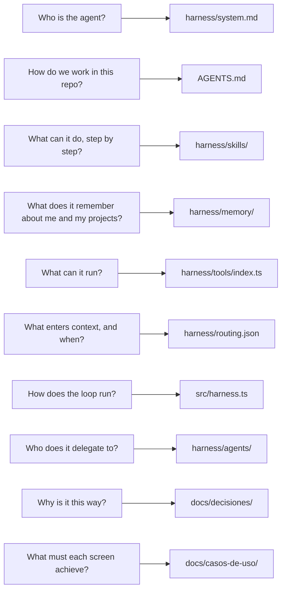

---

## 5. The agent loop

There is no "agency module" inside the model. `runAgent()` in `src/harness.ts` is a four-step cycle. What happens when the window fills lives apart, in `src/window.ts`:

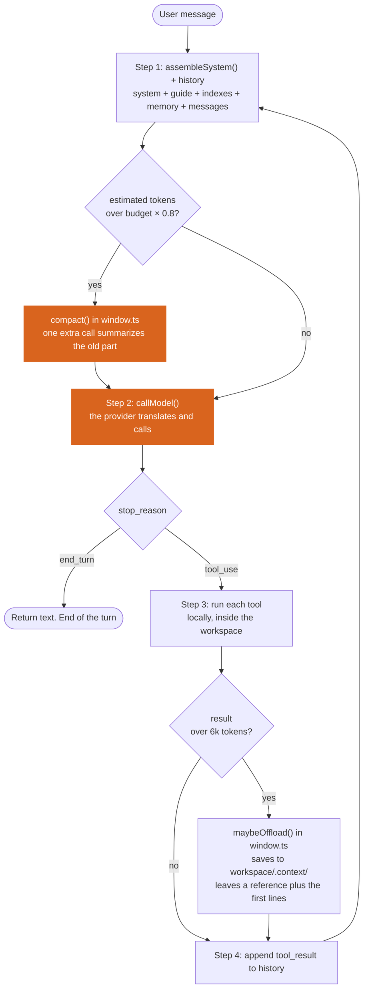

What this means, and what the chat shows you:

- **One turn can be many calls.** The inspector's "calls (turn)" counter makes that visible.
- **Context only grows inside the turn.** Each call resends everything so far. That is why compaction and disk offload exist.
- **The loop has a cap** (`maxToolLoops` in `routing.json`). A model that asks for tools forever is a bug, not a virtue.

Full sequence of a turn with one tool:

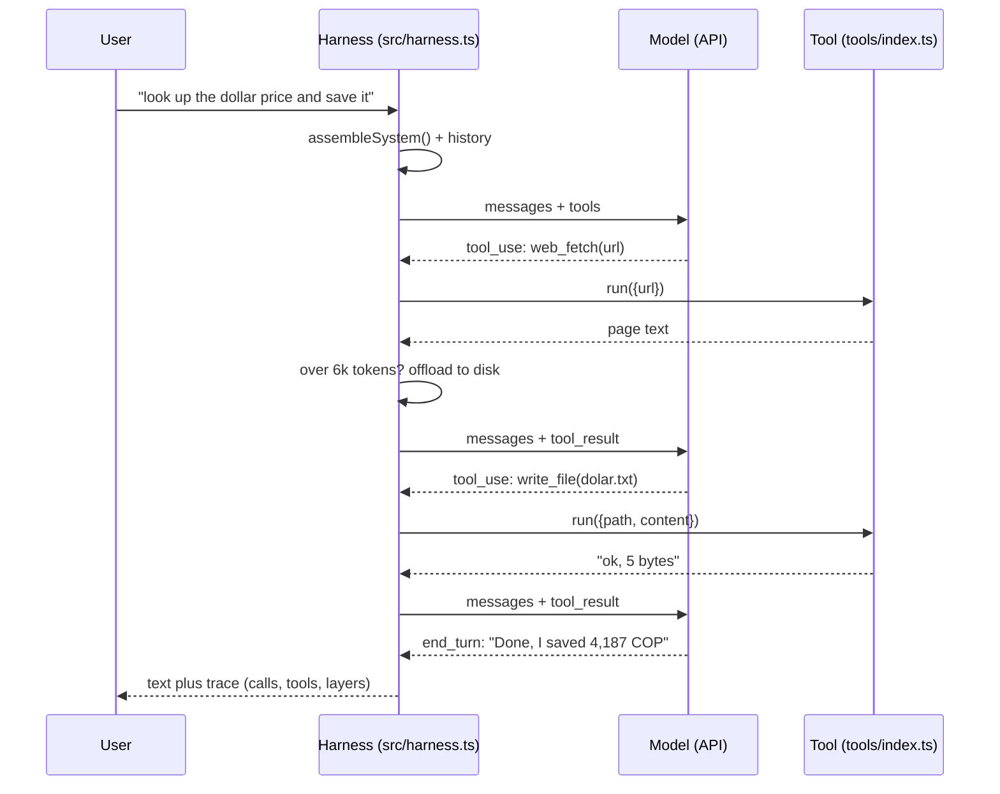

### One loop, several models: Claude, Gemini, and Ollama

The loop does not know which model it is talking to. It works with a history in an internal format (`text`, `tool_use`, and `tool_result` blocks) and `callModel()` hands that to a provider, which translates it to that API and translates the reply back.

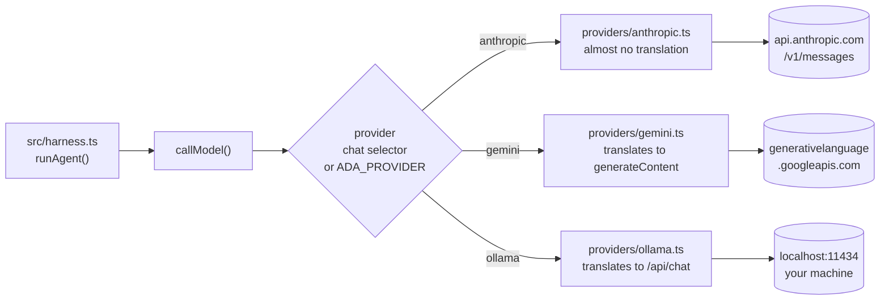

What the Gemini adapter translates:

| Internal format (Claude) | Gemini `generateContent` |
|---|---|
| `system` | `systemInstruction.parts[].text` |
| `tools[].input_schema` | `tools[].functionDeclarations[].parameters` |
| `assistant` role | `model` role |
| `tool_use` block (`id`, `name`, `input`) | `functionCall` part (`id`, `name`, `args`) |
| `tool_result` block | `functionResponse` part with the same `id` and `name`, in a `user` turn |
| `stop_reason: "tool_use"` | there are `functionCall` parts (Gemini still replies `STOP`) |
| `usage.input_tokens` | `usageMetadata.promptTokenCount` |

The delicate part is **thought signatures**. Gemini 3 and 4 attach a `thoughtSignature` to some parts, always to the first `functionCall` of each step, and require it back intact on the next call. If it is missing on the current turn, the API returns 400. The adapter stores it on the internal block as `_gemini.thoughtSignature` and puts it back when translating. The Claude adapter strips those private fields before sending.

That is why **switching provider starts a new conversation**: each API returns signatures and ids that only it understands.

### Local, free models with Ollama

[Ollama](https://ollama.com/download) runs open models on your machine: no key, no per-token cost, and your data stays on your computer. The harness looks for it at startup on `OLLAMA_HOST` (default `http://localhost:11434`) and, if it finds it, offers every installed model in the selector:

- **local, free**: downloaded models that can use tools. Those are the ones the agent can use.
- **cloud, account required**: Ollama cloud models. They run on Ollama's servers and depend on your plan.
- **does not use tools**: shown disabled. An agent without tools cannot read or write anything.

If there is no Claude key and no Gemini key, Ollama is chosen on its own.

```bash
ollama pull qwen3:8b          # about 5 GB, once
npm start                     # "Ollama en http://localhost:11434: qwen3:8b"
```

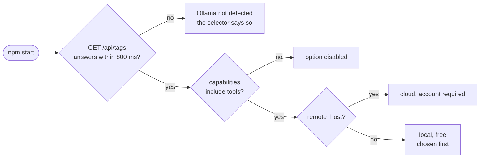

Three things the adapter handles, and that are worth understanding:

| What | Why it matters | What the harness does |
|---|---|---|
| **Context window** | With less than 24 GB of VRAM, Ollama uses 4k tokens by default and silently truncates the start, system prompt included. The harness fixed layers already weigh about 1,700 tokens (`npm run capas`). | Asks for a `num_ctx` of 16,384 (`ADA_OLLAMA_NUM_CTX`, minimum 8,192) and the loop compacts against that window, not against the 120,000 in `routing.json`. The inspector shows the real window. |
| **One model in memory** | Loading a second model for subagents doubles memory on a small machine. | Subagents use the same model, unless you set `ADA_OLLAMA_FAST_MODEL`. |
| **Large results** | In 16k tokens, a 6k result is a third of the window. | The threshold for sending results to disk drops to a quarter of the window. |

What the Ollama adapter translates:

| Internal format | Ollama `/api/chat` |
|---|---|
| `system` | first message with role `system` |
| `tools[].input_schema` | `tools[].function.parameters`, with `type: "function"` |
| `tool_use` block | `message.tool_calls[].function` (`name`, `arguments` as an object; `id` only if Ollama sent one) |
| `tool_result` block | one `tool` role message per result, with `tool_name` and `tool_call_id` if it exists |
| `usage.input_tokens` | `prompt_eval_count` |

Suggested models to start with, by tool support and size (the list changes fast; try them on your own tasks):

| Model | Download, about | For |
|---|---|---|
| `qwen3:8b` | 5 GB | General agent: tools and reasoning across calls |
| `llama3.1:8b` | 5 GB | A widely used alternative in examples and tutorials |
| `qwen3:4b` | 2.5 GB | Machines with little memory; less reliable on long tasks |

A local 8B model is much smaller than Claude or Gemini. It follows simple steps, and it picks the wrong tool more often and loses the thread on long tasks. It is the best way to see the harness work without paying, and a clear lesson in how much of the result depends on the model and how much on the context.

### Add another provider

To add one (OpenAI, Mistral, and so on), create `src/providers/<name>.js` with the same contract and register it in `src/providers/index.ts`. The contract is the `Provider` interface in `src/types.ts`. Annotate your object with `@satisfies` and `npm run typecheck` tells you if something is missing. The import in JSDoc keeps the `.js` suffix:

```js
/** @satisfies {import("../types.js").Provider} */
export const myProvider = {
  name, label, keyEnv, model(), fastModel(), configured(),
  call({ model, system, messages, tools, maxTokens }),   // -> { content, stop_reason, usage }
  refresh?(), contextWindow?(model), status?(),          // optional, Ollama uses them
};
```

Then add its tests in `tests/providers/`, with `fakeFetch` from `tests/helpers/`: simulate the API with replies in its documented format and check the translation both ways, especially tool ids and private fields.

---

## 6. When the window fills

The window has a hard limit, but quality drops much earlier: with the window half full the model splits attention across too much text and loses what is in the middle. The harness has three moves, and this template runs two of them on its own.

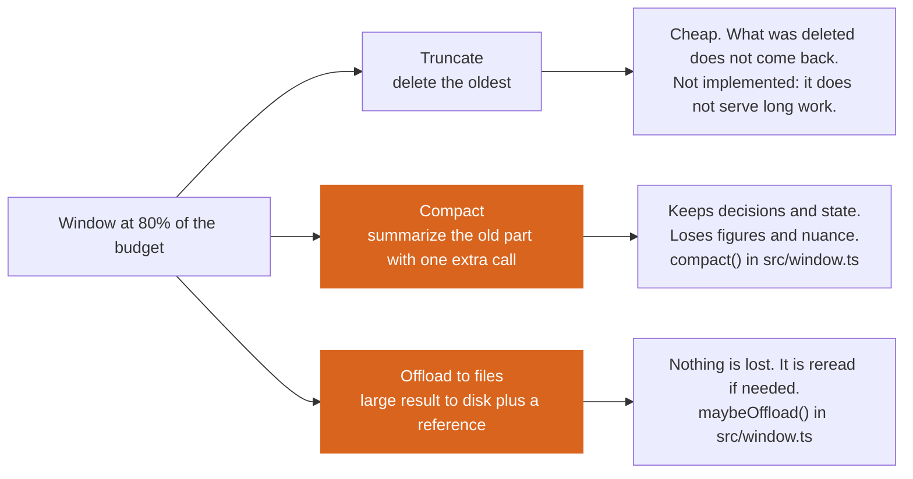

Parameters in `harness/routing.json`:

```jsonc
{
  "contextBudgetTokens": 120000,     // budget, not the model's limit
  "compactAt": 0.8,                   // compact at 80%
  "keepLastMessagesOnCompact": 4,     // the last N messages stay intact
  "layers": { "toolResults": { "offloadAbove": 6000, "offloadTo": ".context" } }   // inside the workspace
}
```

All of this lives in `src/window.ts`, separate from the loop:

| Function | What it decides | Tested without a model |
|---|---|---|
| `budgetFor()` | The real budget: `routing.json` or the model's window, whichever is smaller | Yes |
| `planCompaction()` | `"ok"`, `"compact"`, or `"full"` (the fixed part no longer fits and summarizing frees nothing) | Yes |
| `compact()` | Summarizes the old part with the fast model and leaves the last messages intact | With a fake provider |
| `maybeOffload()` | If a result passes `offloadAbove` or a quarter of the window, it saves it to disk | Yes |

One implementation detail that matters: the API requires history to alternate `user` and `assistant` and to start with `user`. `compact()` replaces the old part with a `user` (summary) plus `assistant` (acknowledgement) pair and trims the tail so it keeps alternating.

---

## 7. Subagents

A subagent is **another context window**, empty, running the same loop with its own system prompt and a subset of tools. It does not see the parent's conversation. Its final report comes back as one more `tool_result`.

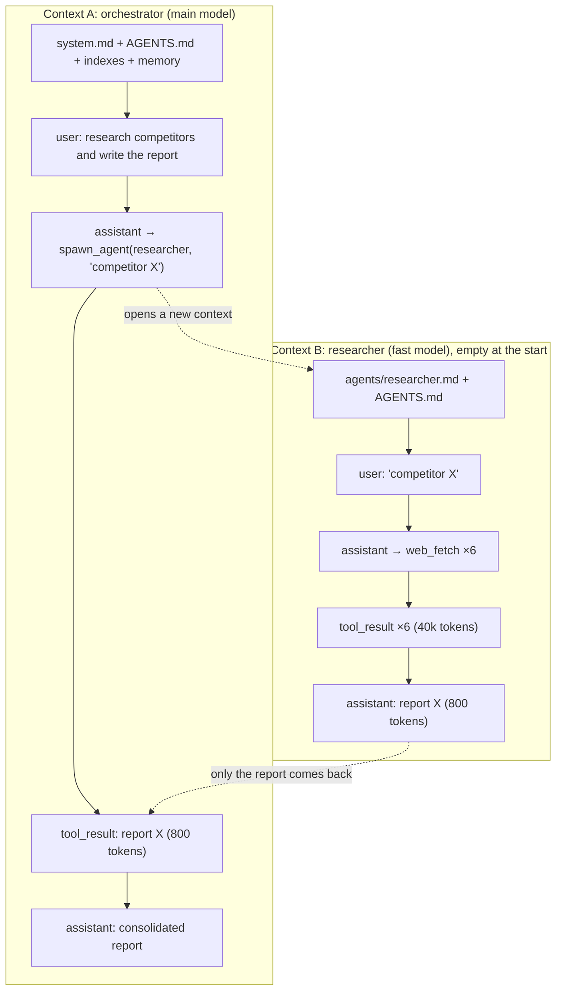

The 40k search tokens stay in B. A receives 800. That asymmetry is why subagents exist.

The template ships four:

| Agent | For | Tools | Model |
|---|---|---|---|
| `researcher` | Explore and summarize | `list_dir`, `read_file`, `web_fetch` | fast |
| `reviewer` | Review one change and run its tests | `list_dir`, `read_file`, `run_command` | fast |
| `frontend` | Build screens with use cases and tests first | the read tools, `write_file`, `run_command`, `load_skill` | main |
| `qa` | Review the whole project against decisions, use cases, and tests. It does not write | the read tools, `run_command`, `load_skill` | main |

An agent is a file and an entry in `routing.json`, not code ([decision 0008](docs/decisiones/0008-agentes-por-archivo.md)). The harness builds `spawn_agent` each turn from that index, the same way it builds the skills index:

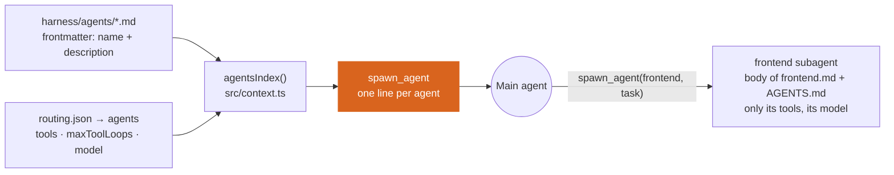

What configures each one:

| | Where | What it controls |
|---|---|---|
| System prompt | body of `harness/agents/<name>.md` | Role, process, report format, maximum size |
| When the model picks it | frontmatter `description` | One line inside `spawn_agent`. It travels on every call: keep it short |
| Visible tools | `routing.json` → `agents.<name>.tools` | A researcher does not write; a reviewer does not browse |
| Iteration cap | `routing.json` → `agents.<name>.maxToolLoops` | Maximum cost per delegation |
| Model | `routing.json` → `agents.<name>.model` | `"fast"` (the default) or `"main"`. The fast model comes from `ADA_*_FAST_MODEL`. With Ollama, the default is the same model |

When **not** to use them: if the task depends on what is already in the parent's context, the subagent starts cold and you have to write everything into the task. That only adds latency and lost information.

---

## 8. The minimal chat and its inspector

`app/` is one screen: the conversation on the left, the inspector on the right. The inspector is the explainer's diagram, live. At the top, the **Model** selector shows providers that have a key and each detected Ollama model, and the inspector says which one the last call talked to and how large its window is.

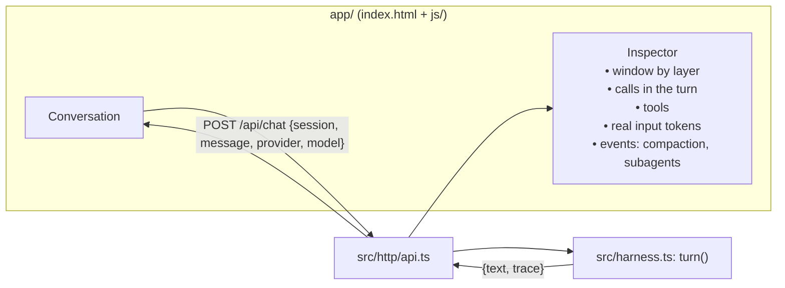

What to look at in the inspector after each message:

- **Window by layer.** What each layer weighed on the last call. Tool definitions and history weigh much more than your message.
- **Real input tokens.** `usage.input_tokens` from the API, next to the local estimate (4 characters per token). The gap calibrates the estimator.
- **Loop events.** Each tool with its input trimmed, each compaction with how many messages it summarized, each subagent with its calls.

History lives in `.sessions/sessions.json` (`createSessionStore()` in `src/http/api.ts`). Restarting the server keeps it. `ADA_SESSIONS` moves the folder. The page starts empty after a reload; the same browser keeps the session id, so the model still has the turns. The tools cannot read `.sessions`.

How the chat is built, so it stays easy to change:

- **No build for the chat.** HTML, one CSS file, and native ES modules the browser loads as they are. `npm install` and `npm start` compile the engine that serves those files.
- **What decides is separate from what paints.** Each decision is a pure function: `debeEnviar()` and `lineasDeRespuesta()` in `conversacion.js`, `buildOptions()` in `selector.js`, `inspectorView()` in `inspector.js`. The `render*()` functions only paint, and `main.js` only wires them. Tests run the pure functions in Node, with no browser ([decision 0003](docs/decisiones/0003-vista-pura-render-delgado.md)).
- **Model text is always text.** Everything is inserted with `textContent`. A test fails if any module uses `innerHTML`, so a reply with `` shows up literally and does not run.

### Building screens: use cases and tests first

Every change a person would notice on screen follows the same cycle ([decision 0007](docs/decisiones/0007-casos-de-uso-y-tdd.md)). The full procedure is in the [`frontend-tdd`](harness/skills/frontend-tdd/SKILL.md) skill, and the rules are in its [`arquitectura.md`](harness/skills/frontend-tdd/arquitectura.md).

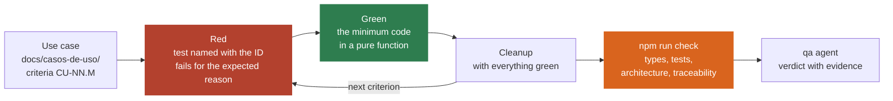

| Piece | Where | What it adds |
|---|---|---|
| Use cases | [`docs/casos-de-uso/`](docs/casos-de-uso/README.md) | What the person must be able to do, with numbered "Given, when, then" criteria |
| Tests per criterion | `tests/unit/app/<module>.test.js` | Each test name starts with the id of the criterion it covers |
| Traceability | `npm run trazabilidad` | Each criterion against its tests. `casos-de-uso.test.js` fails if one has none |
| Checkable rules | `tests/unit/arquitectura.test.js` | Fails if `app/` imports a package, uses `innerHTML`, or a module with logic has no tests |
| Who implements | `frontend` agent | In the harness, with `spawn_agent`; in Claude Code, with `.claude/agents/frontend.md` |
| Who reviews | `qa` agent | Runs the check and the traceability, and compares the code with the decisions and the README with the files |

The four chat use cases (talk, pick a model, inspect the context, start over) have 24 criteria: 22 covered by tests and 2 checked by looking at the screen.

---

## 9. Install and use

```bash
git clone https://github.com/ada-school/ada-harness.git
cd ada-harness
cp .env.example .env          # put a Claude or Gemini key, or none if you use Ollama
npm install
npm start                     # http://localhost:3000
```

The same command opens the chat, runs one turn, or measures the layers. `npm start` is `ada serve`.

```bash
npm run cli -- "List the files in the workspace and tell me what is there"
npm run cli -- --gemini "The same, with Gemini"
npm run cli -- --ollama --model=qwen3:8b "The same, local and free"
node bin/ada.js --help
```

`npm start` builds `dist/` and opens the chat. `npx ada` opens the chat in this repo only after that build. Do not use `npx ada-harness` against the registry: the package is not published.

How much does the context weigh before you write anything? `npm run capas` measures it without calling a model:

```
  system              214
  projectGuide        362
  skillsIndex         126
  memoryCore          122
  memoryIndex           7
  toolDefinitions     897
  total              1728
```

Variables in `.env`:

| Variable | Default | For |
|---|---|---|
| `ANTHROPIC_API_KEY` | (empty) | Claude key |
| `GEMINI_API_KEY` | (empty) | Gemini key. `GOOGLE_API_KEY` is also accepted |
| `ADA_PROVIDER` | the first one ready | `anthropic`, `gemini`, or `ollama` |
| `ADA_ANTHROPIC_MODEL` | `claude-sonnet-5-5` | Main agent with Claude. `ADA_MODEL` still works |
| `ADA_ANTHROPIC_FAST_MODEL` | `claude-haiku-5-5` | Subagents and compaction with Claude |
| `ADA_GEMINI_MODEL` | `gemini-3.8-flash` | Main agent with Gemini |
| `ADA_GEMINI_FAST_MODEL` | `gemini-3.5-flash-lite` | Subagents and compaction with Gemini |
| `OLLAMA_HOST` | `http://localhost:11434` | Where to look for Ollama |
| `ADA_OLLAMA_MODEL` | the first local model with tools | Fixed Ollama model |
| `ADA_OLLAMA_FAST_MODEL` | the same model | Subagents with Ollama. Another model means more memory |
| `ADA_OLLAMA_NUM_CTX` | `16384` | Window requested from Ollama. Minimum 8,192 |
| `ADA_WORKSPACE` | `workspace/` | Folder where the agent reads, writes, and runs. Point it at a real project to work on that project |
| `ADA_MEMORY` | `harness/memory/` | The agent's memory folder. Tests point it at a temporary one |
| `ADA_SESSIONS` | `.sessions/` | Chat history on disk. Tests point it at a temporary folder |
| `PORT` | `3000` | Server port |
| `ADA_HOST` | `127.0.0.1` | Where the server listens. This machine only, by default. Open it to your network only on purpose |
| `ADA_LANG` | `en` | `es` selects the Spanish error sentences. Any other value is English |

You need a key, or Ollama running with at least one model that uses tools.

Server routes:

| Route | Method | What it does |
|---|---|---|
| `/` | GET | The chat |
| `/docs/Anatomía de un Agente.html` | GET | The explainer |
| `/api/providers` | GET | Providers, their model, whether they have a key, and Ollama with the models it detected |
| `/api/chat` | POST `{session, message, provider, model}` | One turn. Without `Accept`, returns `{text, trace, reset}`. With `Accept: text/event-stream`, sends the text in pieces and then that same object ([0012](docs/decisiones/0012-respuesta-en-trozos.md)) |
| `/api/reset` | POST | Clears every session |

The API only serves the chat itself: the server listens on `127.0.0.1`, and a POST needs `application/json` and an `Origin` of its own (or none, as with `curl`). Another page open in your browser cannot use it ([decision 0006](docs/decisiones/0006-sandbox-y-archivos-protegidos.md)).

### Tests and types

`npm install` brings TypeScript, a development tool, and `npm run build` writes `dist/`. That is what Node runs. Shared types live in `src/types.ts` and export no runtime value. The engine sources are the `.ts` files under `src/` and `harness/tools/`. `app/`, the tests, and `bin/ada.js` stay JavaScript. `bin/ada.js` imports `dist/`.

```bash
npm test                      # 126 tests: unit, providers, and integration
npm run test:unit             # one layer
npm run trazabilidad          # each use-case criterion against its tests
npm run typecheck             # types. The build writes dist/ first
npm run check                 # types plus tests: run it before a commit
```

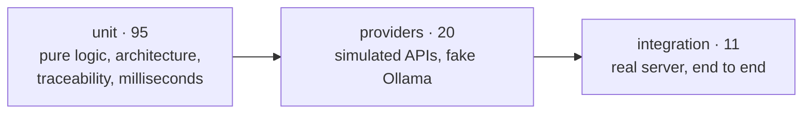

No test uses keys or reaches the internet. Claude and Gemini are simulated with `fakeFetch`, Ollama with a server that imitates `/api/tags`, `/api/show`, and `/api/chat`, and each test works in a temporary workspace and memory (`ADA_WORKSPACE`, `ADA_MEMORY`): running them leaves no trace in the repo. GitHub Actions runs types and tests on Node 18, 20, and 22 on every push (`.github/workflows/ci.yml`).

Two files in `tests/unit/` do not test functions. They test project rules. `arquitectura.test.js` checks the decisions that can be checked (no packages in the chat, no `innerHTML`, one test file per module with logic) and `casos-de-uso.test.js` checks that every criterion has its test. If one of them fails, do not edit it so it passes: read the decision it cites.

The tests that matter most are the security tests in `tests/unit/tools.test.js`: the agent does not leave the workspace (not with `../`, absolute paths, or a sibling folder with the same prefix), it does not read or write `.env` or `.git` at any level, including inside the workspace, `write_memory` does not write outside `areas/`, `web_fetch` does not enter the internal network, and the server API does not serve other pages. If you change `inside()`, `resolveReadable()`, `urlPublica()`, or `peticionPermitida()`, those tests tell you whether you opened a hole.

---

## 10. Point it at your project

The harness is not the software. The software is the `ADA_WORKSPACE` folder.

```bash
# in .env, absolute path of the repo you want to build
ADA_WORKSPACE=/path/to/your/repo
```

There the agent reads, writes, and runs commands. That repo's `.env` and `.git` stay protected. Then, in order of impact per minute spent:

1. **`AGENTS.md`.** Stack, commands, conventions, what not to touch. It is the cheapest layer and the most effective. One rule here is worth more than repeating it in every message.
2. **`harness/memory/profile.md` and `preferences.md`.** Write them by hand the first time. The agent only writes in `areas/`.
3. **Skills.** A skill is a procedure, not an encyclopedia. The frontmatter `description` is the trigger: write it as "load this when…". If it passes 200 lines, split it.
4. **Tools.** Register a new one in `harness/tools/index.ts`: an object with `definition` (JSON the model sees) and `run` (function). The schema has to fit `src/validation.ts` (`additionalProperties: false`). Keep paths inside `ADA_WORKSPACE` with `inside()` and add the test in `tests/unit/tools.test.js`.
5. **Subagents.** Add `harness/agents/<name>.md` with frontmatter (`name` and a one-line `description`) and its entry in `routing.json`: tools, iteration cap, and model. `spawn_agent` offers it on its own.
6. **`routing.json`.** Adjust the budget and thresholds for the model and the kind of work. Long work with many files: lower `offloadAbove`. Short conversation: raise `compactAt`.
7. **Decisions and use cases.** When you make a decision someone might question, write it in `docs/decisiones/` with the test that checks it. When your project has screens, write their use cases and let the `frontend` agent follow the tests-first cycle.

Another model? Add a provider in `src/providers/` (see [Add another provider](#add-another-provider)). The rest of the harness does not change.

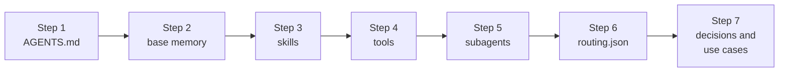

---

## 11. Principles this structure enforces

| Principle | Where it lives in the code |
|---|---|
| **Index in, body out.** Skills, memory, and large results are listed in context and loaded in full only when needed. | `context.ts` (indexes), `load_skill`, `read_memory`, `window.ts` → `maybeOffload()` |
| **Context focuses, it does not teach.** If the model needs something it does not know, a tool brings it in as text. | `tools/index.ts` |
| **Degrade before the limit.** Compact at 80%, not at 100%. | `routing.json` → `compactAt`, `window.ts` → `compact()` |
| **Isolate the noisy work.** Research, review, screen implementation, and QA in subagents, each with its own context. | `spawnAgent()`, `agents/`, `routing.json` → `agents` |
| **Everything is text.** Each layer is a file. If you cannot read it, it is not in the harness. | all of `harness/` |
| **The model proposes, the harness runs.** Nothing runs without a registered function, a valid schema, and an allowed folder. | `runAgent()`, `validateInput()`, `inside()` |
| **Secrets are not context.** The agent cannot read `.env` or `.git`, not even from the repo root. | `config.ts` → `isProtected()`, `resolveReadable()` |
| **What decides is pure. What touches the world is thin.** Rules are tested with no network, no model, and no browser. | `window.ts`, `app/js/*`, `tests/` |
| **The model is replaceable.** The loop speaks an internal format. Each provider translates both ways. | `src/providers/` |
| **Criterion first, then the test, then the code.** A screen is done when every criterion of its use case has a test that names it. | `docs/casos-de-uso/`, `frontend-tdd` skill, `casos-de-uso.test.js` |
| **A decision that is not checked is a suggestion.** Each architecture decision says which test fails if someone breaks it. | `docs/decisiones/`, `arquitectura.test.js` |

### Architecture decisions

The reason for each piece is in [`docs/decisiones/`](docs/decisiones/README.md), one decision per file:

| # | Decision | Checked in |
|---|---|---|
| [0001](docs/decisiones/0001-interfaz-sin-compilacion.md) | The chat stays without a build step | `arquitectura.test.js` |
| [0002](docs/decisiones/0002-formato-interno-y-proveedores.md) | One internal message format and one adapter per provider | `tests/providers/` |
| [0003](docs/decisiones/0003-vista-pura-render-delgado.md) | In the chat, logic is pure and render does not decide | `arquitectura.test.js`, `tests/unit/app/` |
| [0004](docs/decisiones/0004-tipos-con-jsdoc.md) | Types in JSDoc, checked by TypeScript, with no compile step | `npm run typecheck` |
| [0005](docs/decisiones/0005-pruebas-sin-red.md) | Tests in three layers, with no keys and no network | `tests/run.js`, CI |
| [0006](docs/decisiones/0006-sandbox-y-archivos-protegidos.md) | Tools do not leave the workspace and do not touch secrets | `tools.test.js` |
| [0007](docs/decisiones/0007-casos-de-uso-y-tdd.md) | The front end is built with use cases and tests first | `casos-de-uso.test.js` |
| [0008](docs/decisiones/0008-agentes-por-archivo.md) | An agent is a file and an entry in routing.json | `agentes.test.js` |
| [0009](docs/decisiones/0009-validacion-de-herramientas.md) | The server validates each tool's arguments | `validation.test.js`, `harness.test.js` |
| [0010](docs/decisiones/0010-comando-unico.md) | One command for the chat and the terminal | `http-cli.test.js`, `arquitectura.test.js` |
| [0011](docs/decisiones/0011-ingles-typescript-y-librerias.md) | English, TypeScript in phases, and no React for the chat | `docs/BACKLOG.md`, phase by phase |

---

## 12. Known limits

- **Token estimate.** 4 characters per token is what decides compaction, before the call. After the call, the inspector shows the API's input and output counts beside that estimate. There is no separate `count_tokens` request.
- **Sandbox is macOS only.** `run_command` still has no shell and a 60-second limit. On macOS it runs under Seatbelt: it can read and write the workspace, and it can read system libraries and its own install prefix. It cannot read the home directory, so a `.env` outside the workspace stays closed, and it cannot write outside the workspace. On Linux it is still the workspace directory and the timeout. It is not a container ([decision 0006](docs/decisiones/0006-sandbox-y-archivos-protegidos.md)).
- **Streaming is partial.** Ollama sends text as it arrives. Claude and Gemini still send the finished reply as one piece.
- **The screen starts empty after a reload.** The model still has the turns. The page does not redraw them.
- **No UI framework.** The chat is seven small modules and that is enough. React stays out: one screen does not justify it ([decision 0011](docs/decisiones/0011-ingles-typescript-y-librerias.md)). Chat and terminal start from `bin/ada.js` ([decision 0010](docs/decisiones/0010-comando-unico.md)). The move to English and TypeScript is in [`docs/BACKLOG.md`](docs/BACKLOG.md).
- **The frontend and qa agents need a capable model.** That is why they use the main model. With a local 8B model, the tests-first cycle usually gets lost halfway. For that work, use Claude or Gemini.
- **One model per conversation.** Switching model or provider starts a new conversation, because one API's signatures and ids do not work on another, and a history written by one model confuses the next.
- **Local models are more limited.** An 8B model on Ollama picks tools worse and loses the thread sooner on long tasks. And its real window (16k by default) fills much faster: compaction shows up in short conversations.
- **Gemini without advanced options.** The adapter uses `generateContent` at the model's default reasoning level, with no streaming and no cache. Tests simulate the API with the documented format: before a workshop, do one real turn with your key.
- **No prompt cache.** The API can cache the system block and the tools to make repeated calls cheaper. It does not change the window size, only the cost.

---

## Developing this repo with Claude Code

This repo has two guides because two different agents work in it:

| | `AGENTS.md` | `CLAUDE.md` |
|---|---|---|
| Who reads it | The agent that runs inside the harness | Claude Code, when you develop the harness |
| Where that agent works | `workspace/` | The whole repo |
| When it loads | Concatenated to the system prompt, on every call | When Claude Code opens this folder. If `CLAUDE.md` exists, Claude Code does not load `AGENTS.md` |

`.claude/` completes the guide for Claude Code:

- **`.claude/agents/frontend.md` and `qa.md`.** The same harness agents, available to Claude Code. They are wrappers of a few lines: the prompt lives in `harness/agents/`, in one place, and both harnesses read it.
- **`.claude/rules/frontend.md`.** Loads on its own when Claude Code opens a file in `app/`, `tests/unit/app/`, or `docs/casos-de-uso/`, and puts the front-end process and rules in front of it.

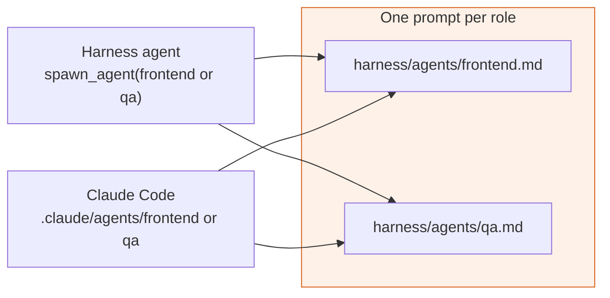

A typical request in Claude Code: "Add a button to copy the last reply. Use the frontend agent, then review with qa." The `frontend` agent writes the use case, the failing test, and the minimum code, and runs `npm run check`. The `qa` agent returns a verdict with evidence.

---

## In-person workshop

`docs/taller/` has everything for the workshop "Open an agent from the inside" (45 minutes): the preparation steps, the template for your first skill, the solved example, and the demo code. Start at [`docs/taller/README.md`](docs/taller/README.md).

---

## References

- Interactive explainer: [`docs/Anatomía de un Agente.html`](docs/Anatom%C3%ADa%20de%20un%20Agente.html)
- Messages API and `stop_reason` handling: https://platform.claude.com/docs/en/build-with-claude/handling-stop-reasons
- Gemini, function calls: https://ai.google.dev/gemini-api/docs/generate-content/function-calling
- Gemini, thought signatures: https://ai.google.dev/gemini-api/docs/generate-content/thought-signatures
- Ollama, tool calls and context length: https://github.com/ollama/ollama/tree/main/docs

## License

MIT. Use it, copy it, improve it.
