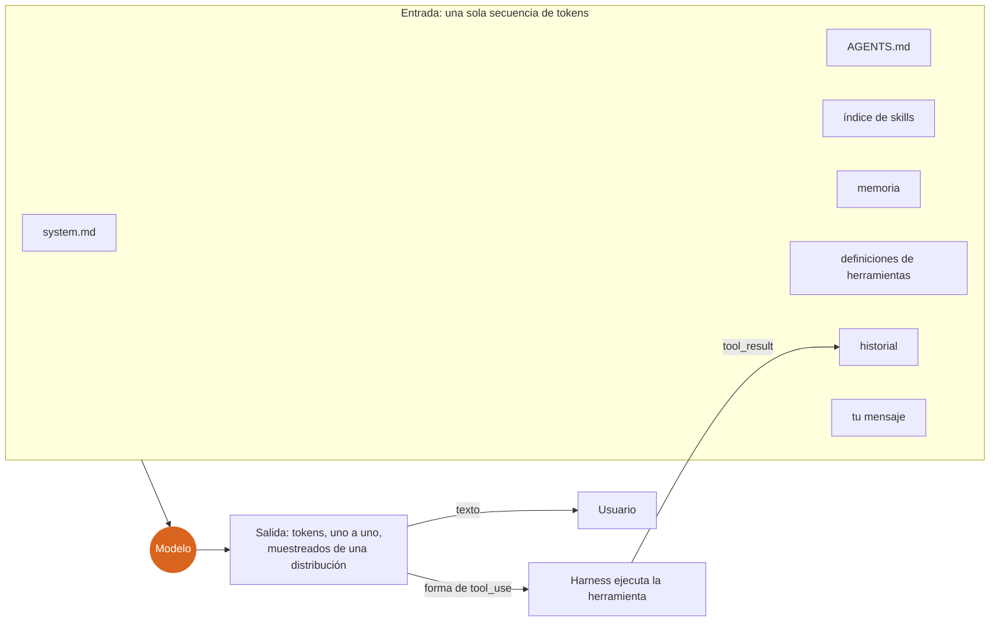
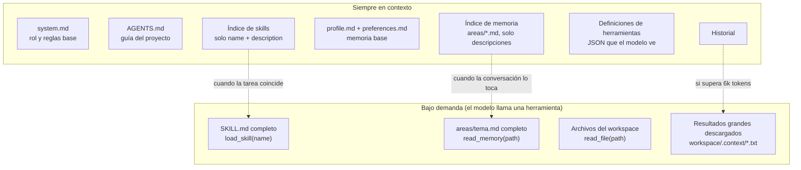
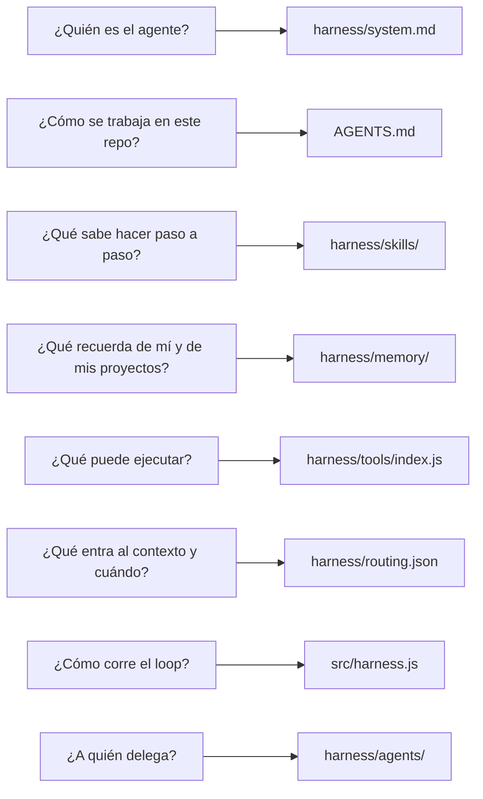
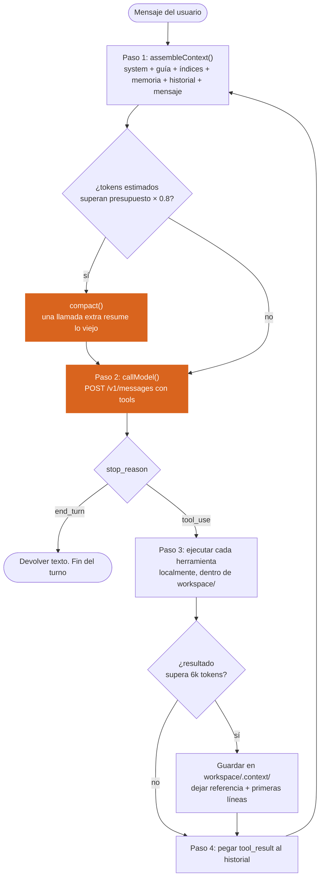
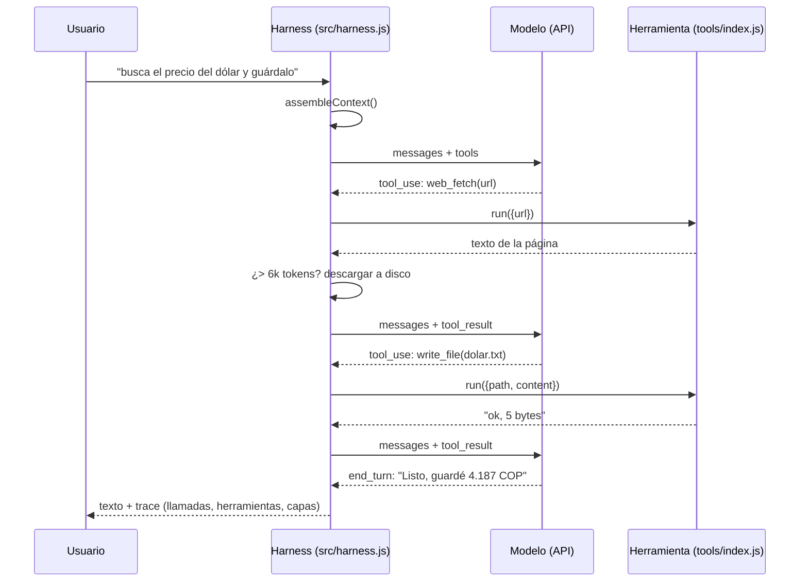
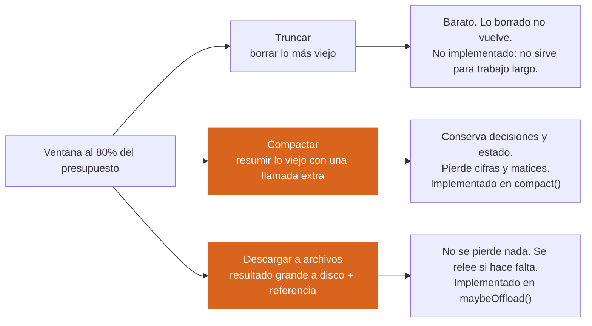
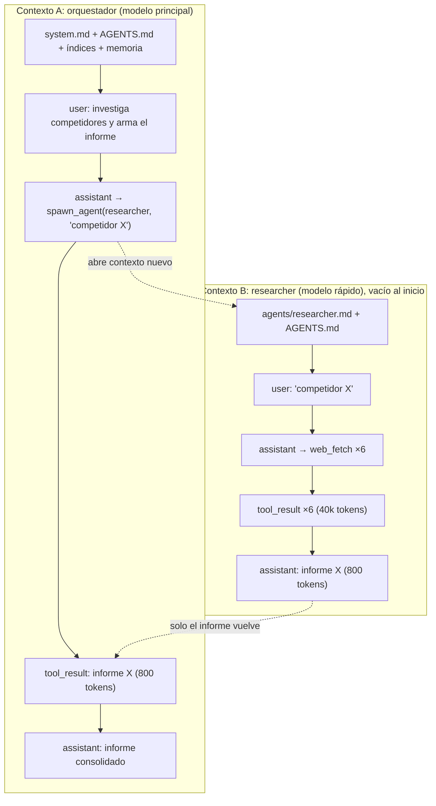
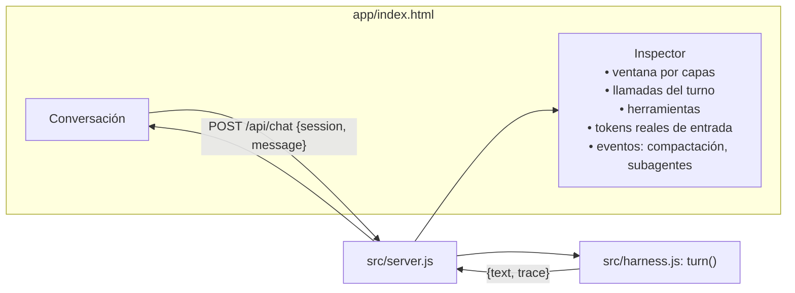
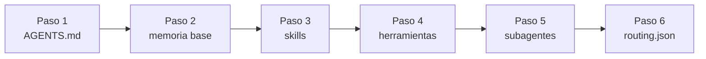

# ADA Harness

**Una plantilla mínima y abierta para construir un AI Harness.**

Un modelo de lenguaje recibe tokens y devuelve tokens. Eso es todo lo que hace. Un *harness* es la estructura alrededor de esa llamada: decide qué tokens entran, ejecuta lo que el modelo pide, y vuelve a llamar. Esta plantilla deja esa estructura explícita en archivos de texto que puedes leer, versionar y cambiar, y la acompaña de un chat mínimo donde ves cada capa funcionando en vivo.

Cero dependencias. Node 18 o superior. Licencia MIT.

---

## Índice

1. [Empieza por el explicador interactivo](#1-empieza-por-el-explicador-interactivo)
2. [La idea en un diagrama](#2-la-idea-en-un-diagrama)
3. [Las capas del contexto](#3-las-capas-del-contexto)
4. [Estructura del repositorio](#4-estructura-del-repositorio)
5. [El loop agéntico](#5-el-loop-agéntico)
6. [Cuando la ventana se llena](#6-cuando-la-ventana-se-llena)
7. [Subagentes](#7-subagentes)
8. [El chat mínimo y su inspector](#8-el-chat-mínimo-y-su-inspector)
9. [Instalación y uso](#9-instalación-y-uso)
10. [Adaptarlo a tu proyecto](#10-adaptarlo-a-tu-proyecto)
11. [Principios que esta estructura hace cumplir](#11-principios-que-esta-estructura-hace-cumplir)
12. [Límites conocidos](#12-límites-conocidos)

---

## 1. Empieza por el explicador interactivo

Este repo nació de un modelo mental, y ese modelo mental está en un solo archivo:

**[`docs/Anatomía de un Agente.html`](docs/Anatom%C3%ADa%20de%20un%20Agente.html)**

Ábrelo en el navegador (o en `http://localhost:3000/docs/Anatom%C3%ADa%20de%20un%20Agente.html` con el servidor corriendo). Son ocho capas, cada una con una pieza interactiva:

| Capa | Qué muestra | Interacción |
|---|---|---|
| 1. La llamada | El modelo elige el siguiente token de una distribución | Slider de temperatura y muestreo |
| 2. El enfoque | El contexto no agrega conocimiento, concentra probabilidad en una región | Mapa animado, escribe tu propio prompt |
| 3. El contexto | Cómo se ensambla el prompt real y cuánto pesa cada capa | Activa y desactiva capas |
| 4. El loop | Un agente es un loop alrededor de la llamada | Avanza paso a paso una tarea real |
| 5. Ventana llena | Degradación antes del límite y las tres jugadas posibles | Llena la ventana, trunca, compacta o descarga |
| 6. Subagentes | Otro contexto, vacío, con el mismo loop | Diagrama de tres contextos |
| 7. Mapa | Tabla de todas las capas: quién las escribe, cuándo entran, si persisten | Referencia |
| 8. Lo invariante | Seis verdades que ninguna capa cambia | Referencia |

Cada carpeta de este repositorio implementa una de esas capas. Las secciones siguientes van en el mismo orden.

---

## 2. La idea en un diagrama



Tres cosas para no olvidar:

- El modelo **no recuerda nada** entre llamadas. Lo que "sabe" es lo que está en la entrada.
- El modelo **no ejecuta nada**. Cuando "usa una herramienta" está emitiendo texto con un formato acordado. El harness lo lee y ejecuta.
- La salida es **probabilística**. Dos llamadas iguales pueden dar resultados distintos.

---

## 3. Las capas del contexto

Todo lo que entra a la llamada es texto, ordenado en capas. Cada capa tiene un dueño, un momento de carga y un costo en tokens. `harness/routing.json` declara cómo se carga cada una.



| Capa | Archivo o fuente | Quién la escribe | Cuándo entra |
|---|---|---|---|
| System prompt | `harness/system.md` | Tú (humano, con aprobación) | Siempre |
| Guía del proyecto | `AGENTS.md` | Tú y tu equipo | Siempre, concatenada al sistema |
| Índice de skills | frontmatter de `harness/skills/*/SKILL.md` | Quien escribe el skill | Siempre |
| Contenido de un skill | cuerpo del `SKILL.md` | Quien escribe el skill | Bajo demanda, `load_skill` |
| Memoria base | `harness/memory/profile.md`, `preferences.md` | Tú, a mano | Siempre |
| Índice de memoria | `harness/memory/areas/*.md` (descripciones) | El agente, con `write_memory` | Siempre |
| Contenido de memoria | cuerpo de `areas/*.md` | El agente | Bajo demanda, `read_memory` |
| Herramientas | `harness/tools/index.js` | Tú | Siempre |
| Historial | memoria del proceso (`src/server.js`) | Tú y el modelo | Siempre, hasta compactar |
| Resultados de herramientas | lo que devuelve cada ejecución | El mundo exterior | Después de cada ejecución |

**Índice adentro, contenido afuera.** Es el patrón que se repite en skills, memoria y resultados grandes. El modelo siempre ve qué existe; carga el contenido completo solo cuando lo necesita. En el explicador esto es "context routing".

---

## 4. Estructura del repositorio

```
ada-harness/
├── AGENTS.md                      Guía del proyecto. Se concatena al system prompt.
├── harness/                       Todo lo que define al agente. Solo texto.
│   ├── system.md                  Rol y reglas base.
│   ├── routing.json               Qué capa entra siempre, bajo demanda o nunca; presupuestos.
│   ├── skills/
│   │   ├── README.md              Cómo escribir un skill.
│   │   ├── commit-convention/SKILL.md
│   │   └── spec-first/SKILL.md
│   ├── memory/
│   │   ├── profile.md             Quién usa el harness.
│   │   ├── preferences.md         Cómo quiere que el agente se comporte.
│   │   └── areas/                 Un archivo por proyecto o tema. El agente los escribe.
│   ├── agents/
│   │   ├── researcher.md          System prompt del subagente investigador.
│   │   └── reviewer.md            System prompt del subagente revisor.
│   └── tools/
│       └── index.js               Cada herramienta: definición JSON + función que la ejecuta.
├── src/
│   ├── context.js                 Ensambla la ventana y reporta tokens por capa.
│   ├── harness.js                 El loop: llamar, ejecutar, descargar, compactar, subagentes.
│   └── server.js                  HTTP mínimo: sirve app/ y docs/, expone POST /api/chat.
├── app/
│   └── index.html                 Chat minimalista con inspector de contexto.
├── docs/
│   └── Anatomía de un Agente.html    El explicador interactivo.
├── workspace/                     Donde el agente lee, escribe y ejecuta. Nada fuera de aquí.
├── .env.example                   ANTHROPIC_API_KEY, modelos, puerto.
├── package.json                   Sin dependencias.
└── LICENSE                        MIT.
```

Qué archivo responde a qué pregunta:



---

## 5. El loop agéntico

No existe un "módulo de agencia" dentro del modelo. `src/harness.js` es un ciclo de cuatro pasos:



Lo que esto implica y el chat te muestra:

- **Un turno puede ser muchas llamadas.** El contador "llamadas (turno)" del inspector lo hace visible.
- **El contexto solo crece dentro del turno.** Cada llamada reenvía todo lo anterior. Por eso existen la compactación y la descarga a disco.
- **El loop tiene un tope** (`maxToolLoops` en `routing.json`). Un modelo que pide herramientas sin parar es un bug, no una virtud.

Secuencia completa de un turno con una herramienta:



---

## 6. Cuando la ventana se llena

La ventana tiene un límite duro, pero la calidad baja mucho antes: con la ventana medio llena el modelo reparte atención entre demasiado texto y pierde lo que está en el medio. El harness tiene tres jugadas, y esta plantilla implementa dos de ellas automáticamente.



Parámetros en `harness/routing.json`:

```jsonc
{
  "contextBudgetTokens": 120000,     // presupuesto, no el límite del modelo
  "compactAt": 0.8,                   // compactar al 80%
  "keepLastMessagesOnCompact": 4,     // los últimos N mensajes quedan intactos
  "layers": { "toolResults": { "offloadAbove": 6000, "offloadTo": "workspace/.context" } }
}
```

Detalle de implementación que importa: la API exige que el historial alterne `user` y `assistant` y empiece en `user`. `compact()` reemplaza lo viejo por un par `user` (resumen) + `assistant` (acuse) y recorta la cola para que siga alternando.

---

## 7. Subagentes

Un subagente es **otra ventana de contexto**, vacía, corriendo el mismo loop con su propio system prompt y un subconjunto de herramientas. No ve la conversación del padre. Su informe final vuelve como un `tool_result` más.



Los 40k tokens de búsqueda se quedan en B. A recibe 800. Esa asimetría es la razón de existir de los subagentes.

Qué configura cada uno:

| | Dónde | Qué controla |
|---|---|---|
| System prompt | `harness/agents/<nombre>.md` | Rol, formato del informe, tamaño máximo |
| Herramientas visibles | `routing.json` → `agents.<nombre>.tools` | Un investigador no escribe; un revisor no navega |
| Tope de iteraciones | `routing.json` → `agents.<nombre>.maxToolLoops` | Costo máximo por delegación |
| Modelo | `.env` → `ADA_FAST_MODEL` | Subagentes y compactación usan el modelo rápido |

Cuándo **no** usarlos: si la tarea depende de lo que ya está en el contexto del padre, el subagente arranca frío y hay que escribirle todo. Ahí solo agregas latencia y pérdida de información.

---

## 8. El chat mínimo y su inspector

`app/index.html` es una pantalla: conversación a la izquierda, inspector a la derecha. El inspector es el diagrama del explicador, en vivo.



Qué mirar en el inspector después de cada mensaje:

- **Ventana por capas.** Cuánto pesó cada capa en la última llamada. Verás que las definiciones de herramientas y el historial pesan mucho más que tu mensaje.
- **Tokens de entrada reales.** `usage.input_tokens` que devuelve la API, al lado del estimado local (4 caracteres por token). La diferencia te calibra el estimador.
- **Eventos del loop.** Cada herramienta con su entrada recortada, cada compactación con cuántos mensajes resumió, cada subagente con sus llamadas.

El historial vive en memoria del proceso (`sessions` en `server.js`). Reiniciar el servidor lo borra. Para persistirlo, guarda el array `history` por sesión en disco.

---

## 9. Instalación y uso

```bash
git clone <este repo> ada-harness
cd ada-harness
cp .env.example .env          # pon tu ANTHROPIC_API_KEY
node src/server.js            # http://localhost:3000
```

Desde la terminal, un turno sin interfaz:

```bash
node src/harness.js "Lista los archivos del workspace y dime qué hay"
```

Variables en `.env`:

| Variable | Default | Para qué |
|---|---|---|
| `ANTHROPIC_API_KEY` | (requerida) | Autenticación con la API |
| `ADA_MODEL` | `claude-sonnet-5-5` | Agente principal |
| `ADA_FAST_MODEL` | `claude-haiku-5-5` | Subagentes y compactación |
| `PORT` | `3000` | Puerto del servidor |

Rutas del servidor:

| Ruta | Método | Qué hace |
|---|---|---|
| `/` | GET | El chat |
| `/docs/Anatomía de un Agente.html` | GET | El explicador |
| `/api/chat` | POST `{session, message}` | Un turno completo. Devuelve `{text, trace}` |
| `/api/reset` | POST | Borra todas las sesiones |

---

## 10. Adaptarlo a tu proyecto

En orden de impacto por minuto invertido:

1. **`AGENTS.md`.** Stack, comandos, convenciones, qué no tocar. Es la capa más barata y la más efectiva. Una regla aquí vale más que repetirla en cada mensaje.
2. **`harness/memory/profile.md` y `preferences.md`.** Escríbelos a mano la primera vez. El agente solo escribe en `areas/`.
3. **Skills.** Un skill es un procedimiento, no una enciclopedia. La `description` del frontmatter es la condición de disparo: escríbela como "cárgalo cuando…". Si pasa de 200 líneas, divídelo.
4. **Herramientas.** Registra una nueva en `harness/tools/index.js`: un objeto con `definition` (JSON que el modelo ve) y `run` (función). Mantén las rutas dentro de `workspace/` con `inside()`.
5. **Subagentes.** Agrega `harness/agents/<nombre>.md` y su entrada en `routing.json`. Añade el nombre al `enum` de `SPAWN_DEF` en `src/harness.js`.
6. **`routing.json`.** Ajusta presupuesto y umbrales según el modelo y el tipo de trabajo. Trabajo largo con muchos archivos: baja `offloadAbove`; conversación corta: sube `compactAt`.



---

## 11. Principios que esta estructura hace cumplir

| Principio | Dónde vive en el código |
|---|---|
| **Índice adentro, contenido afuera.** Skills, memoria y resultados grandes se listan en el contexto y se cargan completos solo cuando hace falta. | `context.js` (índices), `load_skill`, `read_memory`, `maybeOffload()` |
| **El contexto enfoca, no enseña.** Si el modelo necesita algo que no sabe, una herramienta lo trae como texto. | `tools/index.js` |
| **Degradación antes del límite.** Compactar al 80%, no al 100%. | `routing.json` → `compactAt`, `compact()` |
| **Aislar lo ruidoso.** Investigación y revisión en subagentes. | `spawnAgent()`, `agents/` |
| **Todo es texto.** Cada capa es un archivo. Si no puedes leerlo, no está en el harness. | `harness/` entero |
| **El modelo propone, el harness ejecuta.** Nada corre sin pasar por una función registrada y una carpeta permitida. | `runAgent()`, `inside()` |

---

## 12. Límites conocidos

- **Estimación de tokens.** 4 caracteres por token es una aproximación. Para cifras exactas antes de llamar, usa el endpoint `count_tokens` de la API.
- **Sin sandbox real.** `run_command` corre dentro de `workspace/` con timeout y sin shell, pero no es un contenedor. Bien para uso local, no para multiusuario.
- **Sin streaming.** Cada turno devuelve la respuesta completa. Agregar SSE es el siguiente paso natural.
- **Historial en memoria.** Se pierde al reiniciar el servidor.
- **Sin caché de prompt.** La API permite cachear el bloque de sistema y las herramientas para abaratar llamadas repetidas. No cambia el tamaño de la ventana, solo el costo.

---

## Referencias

- Explicador interactivo: [`docs/Anatomía de un Agente.html`](docs/Anatom%C3%ADa%20de%20un%20Agente.html)
- API de mensajes y manejo de `stop_reason`: https://platform.claude.com/docs/en/build-with-claude/handling-stop-reasons

## Licencia

MIT. Úsalo, cópialo, mejóralo.
